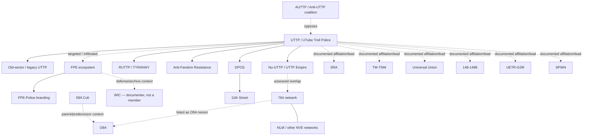

# Entity Map — group level only

This map intentionally contains **no private individuals, addresses, employers,
or family details**. It maps groups, factions, and ecosystems so a reader can
follow the archive without treating it as a target list.

## Relationship table

| From | To | Relationship | Confidence | Note |
| --- | --- | --- | --- | --- |
| UTTP | Old-sector / Nu-UTTP | Internal factions | A/D | Faction labels come from community/WIC records; boundaries are disputed. |
| UTTP | RUTTP/TYRANNY, AFR | Splinters | D | Community-reported; not formally confirmed. |
| UTTP | DPOS | Offshoot/affiliate | A/D | WIC documents DPOS as an offshoot/associate; see `04_OFFSHOOTS/`. |
| UTTP | 764 | Overlap/recruitment pipeline (assessed) | A/C | 764 is independently designated; UTTP-specific pipeline is WIC/community assessment. |
| 764 | O9A | Listed as an O9A nexion in the NZ statement of case; decentralised ecosystem | E/C | Nexions are operationally independent; this is not a command relationship. |
| UTTP | FPE | Target/incursion ecosystem | A | WIC's FPE record; not an alliance. |
| WIC | FPE | Documenter / temporary defense role | A | WIC states it is not an FPE partner and did not accept a governing role. |
| AUTTP | UTTP | Opposition/coalition | D | Community documentation. |
| UTTP | SRA, TM-TNM, UU, 148-1488, UETR-GSR, SPWN | Affiliation/lead folders | A/D | Presence in `03_AFFILIATIONS/` means documented/lead material, not proof of command. |
| 09A Cult | O9A | Legacy archive label for O9A-adjacent material | D | Not a headquarters or proven parent; "09A" is an alternate spelling. |

## Reading rule

A line in this map is a **research relationship**, not a criminal charge. For a
specific allegation, use `CLAIM_LEDGER.md` and the underlying source.
